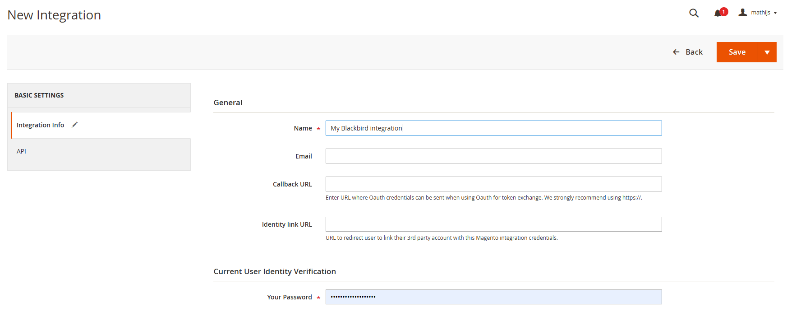
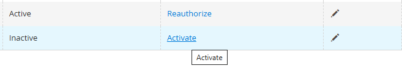
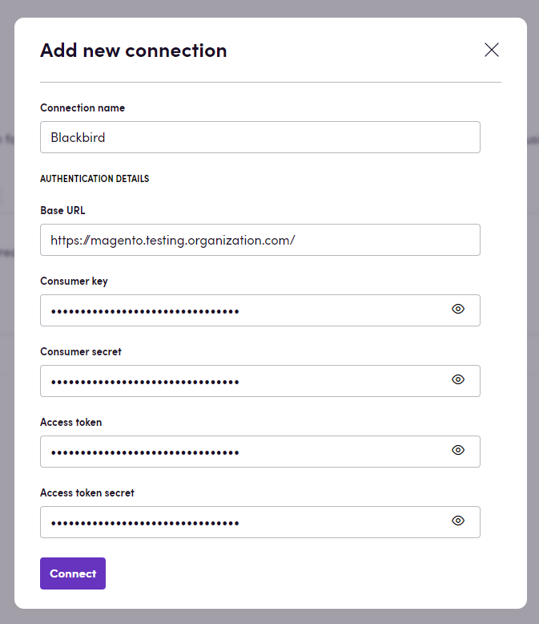
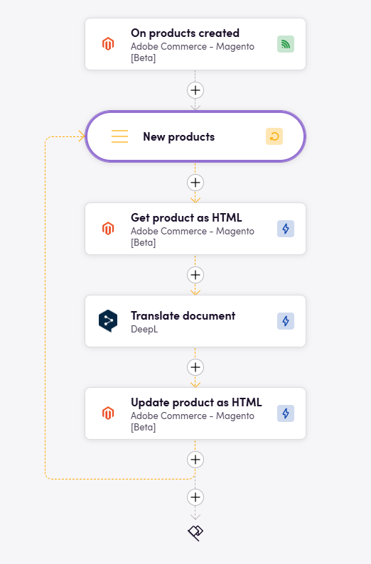

# Blackbird.io Adobe Commerce - Magento

Blackbird is the new automation backbone for the language technology industry. Blackbird provides enterprise-scale automation and orchestration with a simple no-code/low-code platform. Blackbird enables ambitious organizations to identify, vet and automate as many processes as possible. Not just localization workflows, but any business and IT process. This repository represents an application that is deployable on Blackbird and usable inside the workflow editor.

## Introduction

Adobe Commerce is the leading platform for open commerce innovation. It’s designed to be flexible and scalable, able to support businesses of all sizes – from small startups to large enterprises.

<!-- begin docs -->

## Before setting up

- Make sure you have admin level access to Magento.
- You can find the `Base URL` of your Magento URL. It can look like `https://magento.testing.organization.com/`
- In order to receive the `Consumer key`, `Consumer secret`, `Access token` and `Access token secret` you need to create a new integration in your Magento account. Follow the instructions below. 

## Creating an integration

1. Go to `System` -> `Extensions` -> `Integrations`. Click `Add new integration`.

2. Enter the name of the integration. Click on `API` and select resource access `All`*. Note, that you don't need to provide any values for the `Callback URL` and `Identity link URL` fields. 
3. Click save.
4. On the integration overview screen click `Activate`.

5. On the top right corner click `Allow`.
6. You will receive the `Consumer key`, `Consumer secret`, `Access token` and `Access token secret`.

> *You can select all the available resources for the integration to avoid any issues with the permissions. Or select the resources that you need for your specific use case. See the current available functionality of the app below in the documentation.

## Connecting

1. Navigate to Apps, and identify the **Magento** app. You can use search to find it.
2. Click _Add Connection_.
3. Name your connection for future reference e.g. 'My organization'.
4. Fill all the required fields:
    - `Base URL` 
    - `Consumer key`
    - `Consumer secret`
    - `Access token`
    - `Access token secret`
5. Click _Connect_.
6. Confirm that the connection has appeared and the status is _Connected_.

## Actions

### Content

- **Search content** - Search items of supported content types by specific criteria.
- **Download content** - Download content of a specific content item.
- **Upload content** - Upload content.

### Blocks

- **Search blocks** - Search blocks by specific criteria.
- **Get block** - Get block by specified ID.
- **Download block** - Download block content.
- **Create block** - Create a new block.
- **Update block** - Update block with specified data.
- **Upload block** - Upload content of a specific block.
- **Delete block** - Delete block by specified ID.

### Pages

- **Search pages** - Search pages by specific criteria.
- **Get page** - Get page by specified ID.
- **Download page** - Download page content.
- **Create page** - Create a new page.
- **Update page** - Update page by specified ID.
- **Upload page** - Upload page content.
- **Delete page** - Delete page by specified ID.

### Products

- **Search products** - Search products by specific criteria.
- **Get product** - Get product by specified SKU.
- **Download product** - Download product content.
- **Create product** - Create a new product.
- **Update product** - Update product by specified SKU.
- **Upload product** - Upload content of a specific product.
- **Delete product** - Delete product by specified SKU.
- **Add custom attribute** - Add custom attribute to product by specified SKU.

### Categories

- **Search categories** - Search categories by specific criteria.
- **Get category** - Get category by ID.

### Store views

- **Search store views** - Search store views by specific criteria.
- **Get store view** - Get store view by its code.
- **Create store view** - Create a new store view. Requires the Blackbird Store Provisioning extension to be installed on the Magento instance

## Events

### Content

- **On content created or updated** - Triggered when a content item is created or updated.

### Blocks

- **On block created** - Triggered when a new block is created.
- **On block updated** - Triggered when a block is updated.

### Pages

- **On page created** - Triggered when a new page is created.
- **On page updated** - Triggered when a page is updated.

### Products

- **On product created** - Triggered when a product is created.
- **On product updated** - Triggered when a product is updated.

## Example

In the example above you see how you can create a bird that takes newly created products and automatically translates them using NMT.

## Feedback

Do you want to use this app or do you have feedback on our implementation? Reach out to us using the [established channels](https://www.blackbird.io/) or create an issue.

<!-- end docs -->
